# Eye Gaze Attention Monitoring on the Dragonwing IQ-9075

Chain a face detector, a facial landmark model and a gaze estimator on the Dragonwing IQ-9075 NPU, then build an operator attention monitor on top: four NPU inferences per frame at 38 FPS on 1080p video, sized to what a 15-degree gaze model can actually tell you.

**Author:** Samuel Alexander  
**Target:** Qualcomm Dragonwing IQ-9075 EVK  
**Models:** [EyeGaze](https://aihub.qualcomm.com/models/eyegaze), [Lightweight-Face-Detection](https://aihub.qualcomm.com/models/face_det_lite) and [Facial-Landmark-Detection](https://aihub.qualcomm.com/models/facemap_3dmm), all BSD-3-Clause, all compiled through Qualcomm AI Hub  
**Difficulty:** Intermediate. Assumes you have deployed one model to this board before  
**Time:** About 3 hours, including cloud compile jobs and a dataset download  
**Repository:** https://github.com/SamuelAlexander/dragonwing-gaze-attention

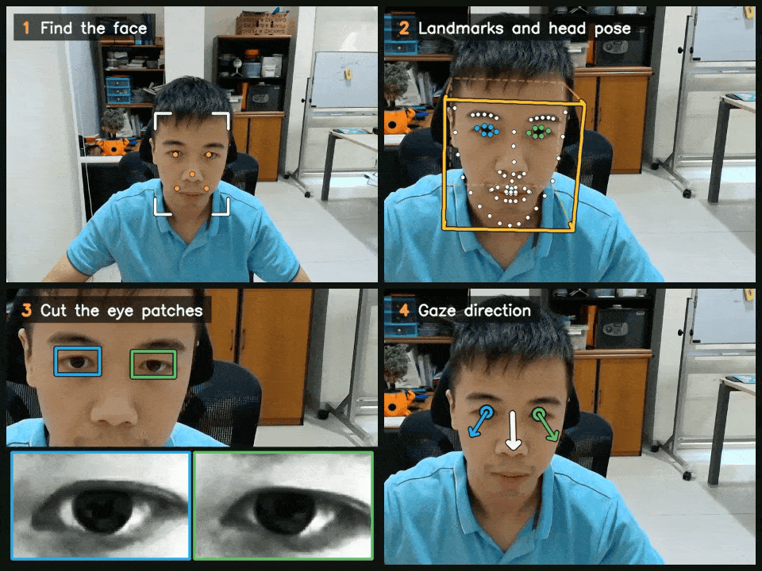

## Present, but not watching

Think of the last screen you were supposed to be watching: a build log, a camera feed, a dashboard, a long video call. At some point your eyes went to your phone and the screen carried on without you. Nobody noticed, including you.

For most screens that costs nothing. For some it does. A control room operator on a night shift, a guard in front of a wall of camera feeds, an inspector at a production line, a driver. Their workplaces can already tell that someone is there: a badge reader, a seat switch, a camera that sees a person in the chair. None of those can tell whether the person is still looking.

Gaze can. A camera that follows where the eyes point notices that they have been on a lap for three seconds. Running it on the device matters as much as running it at all: the video never leaves the room, which makes a camera pointed at someone's face far easier to accept.

There is a catch, and it shapes this whole guide. Small gaze models are coarse. The one used here is off by about 15 degrees on average, a patch 31 cm wide on a screen 60 cm away. It cannot tell you which alarm someone read. It can tell you whether they were looking at the panel, and that is the question those jobs ask.

So this guide builds that monitor on an IQ-9075: three models chained on the NPU, a three-second calibration, and an alert when attention lapses. If you are reading rather than building, the measurements are the part to keep: how to find out what a model's output means before combining it with another, why every model matching its reference does not mean the pipeline does, and how to size an application to a model's real error.

## See it in action

The monitor learns where you should be looking from a three-second calibration, then tracks how far your gaze and your head have moved from it.

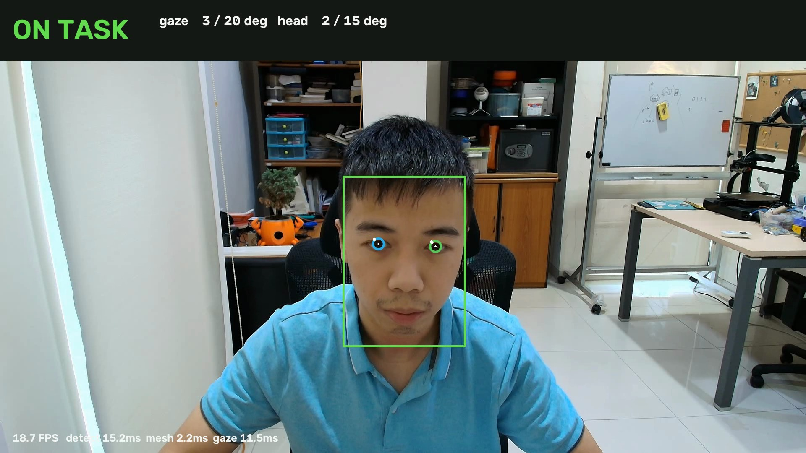

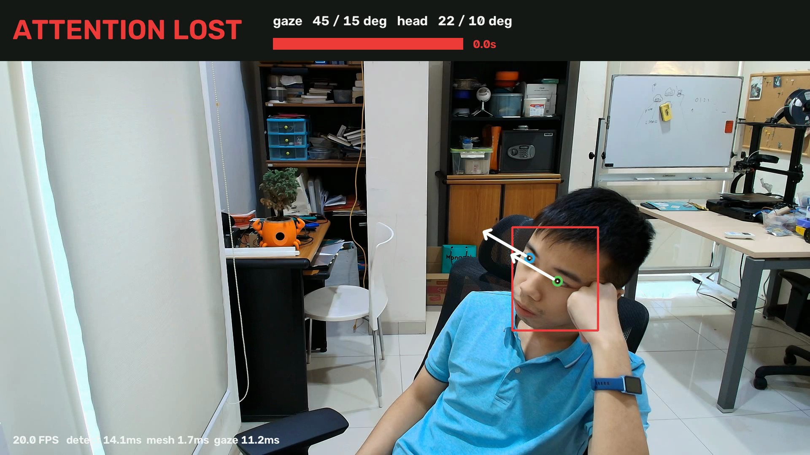

Same clip, same board, seconds apart. The full annotated video is in the repository's `results/` folder.

## How this works

EyeGaze does not take a photograph of a person. It takes a **96x160 grayscale image of one eye** and returns where that eye points. Finding the face, finding the eyes and cutting them out is your job, and it is most of the work. That takes two more models:

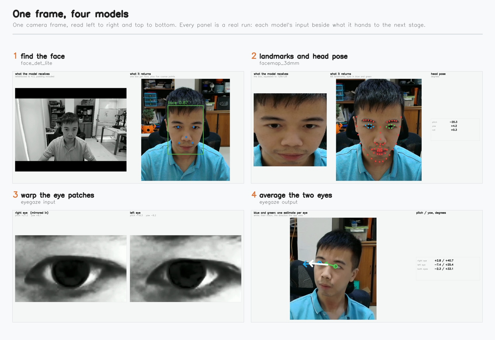

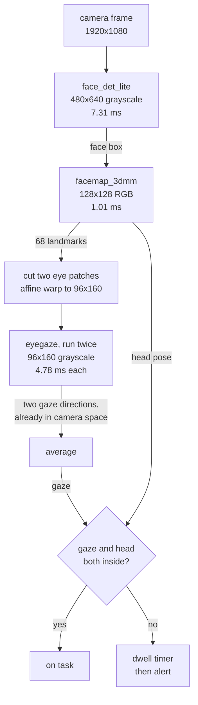

Four NPU inferences per frame, all three models Qualcomm's own. Each figure below is one frame of a real run, showing what a stage receives and what it hands on.

### Stage 1: find the face

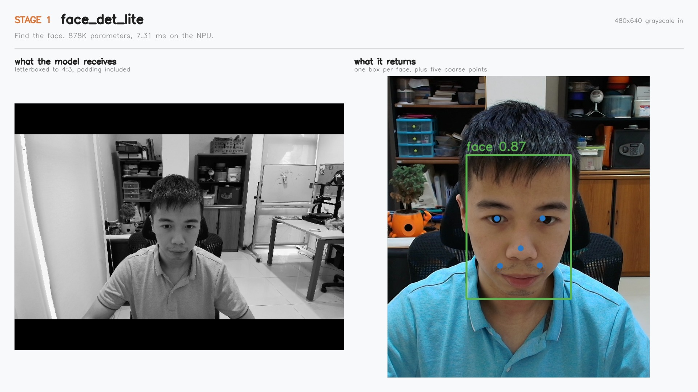

The left panel is the actual input tensor. The model wants 4:3 and a webcam gives 16:9, so the frame is letterboxed (scaled to fit, the rest padded black) instead of squashed. Step 4 shows what squashing costs.

### Stage 2: landmarks and head pose

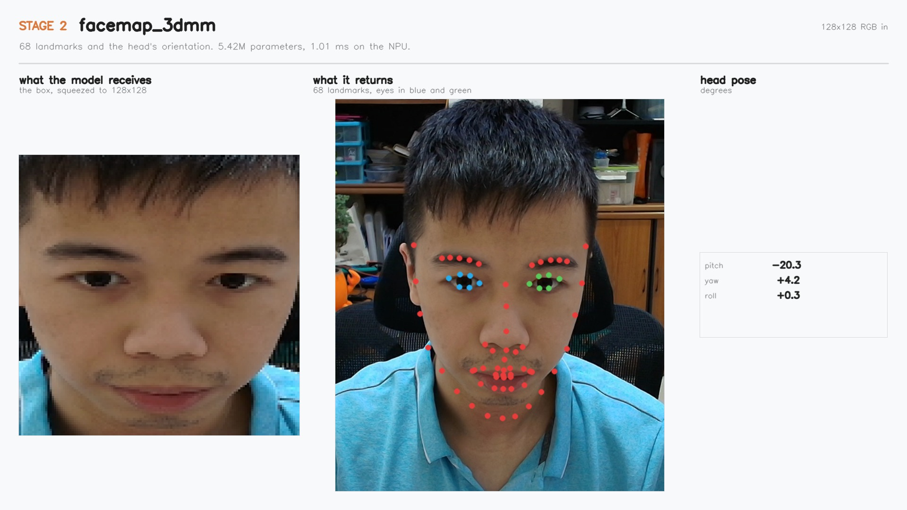

A 128x128 crop of the face, visibly pixelated, is enough to place 68 points on the full-resolution frame and report which way the head is turned. The landmarks tell you where to cut the eyes. The head pose becomes the application's second cue (Stage 5).

### Stage 3: cut the eye patches

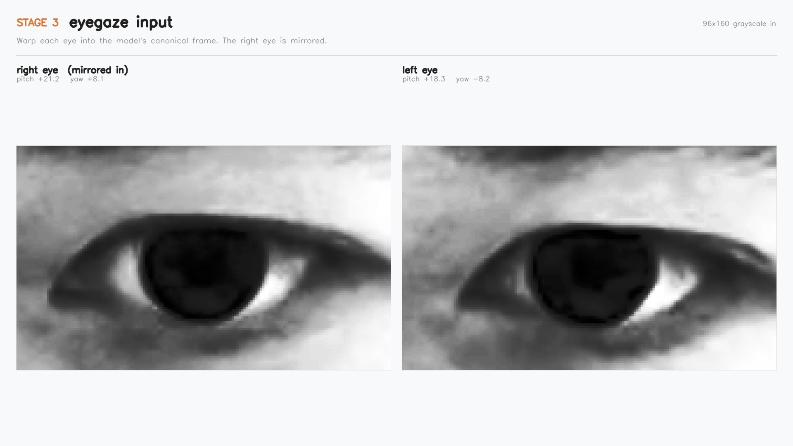

Both patches are warps, not crops: the eye lands at the same place and scale every time, which is the geometry the model was trained on. The right eye is mirrored on the way in and its yaw negated on the way out.

### Stage 4: two eyes, one direction

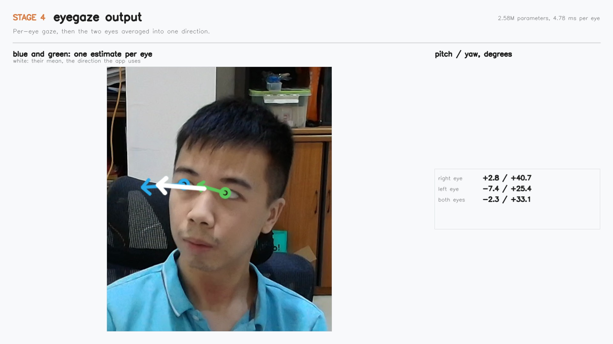

Blue and green are the per-eye estimates. Each carries about 15 degrees of error, so they disagree by around 20. White is their mean and is the direction the application uses. It carries no head pose: EyeGaze already reports gaze relative to the camera (Step 5 has the proof).

### Stage 5: turn a direction into a decision

A direction is not yet an answer. The application adds four things, each sized from a measurement:

| what | why |
|---|---|
| **A calibrated axis**, learned in three seconds | About a third of this model's error is a fixed per-user offset. Calibration subtracts it |
| **A gaze cone**, 20 degrees | Glancing around a whole monitor reads under 12 degrees (p95), because the model under-reads angles |
| **A head limit**, 15 degrees from the calibrated pose | Eyes looking down at a phone barely move the gaze estimate. The head turning toward it does |
| **A dwell timer with hysteresis** | Single frames from a 15-degree model cross any boundary constantly. Smoothing and asymmetric thresholds make the state stable |

Three states, one rule each:

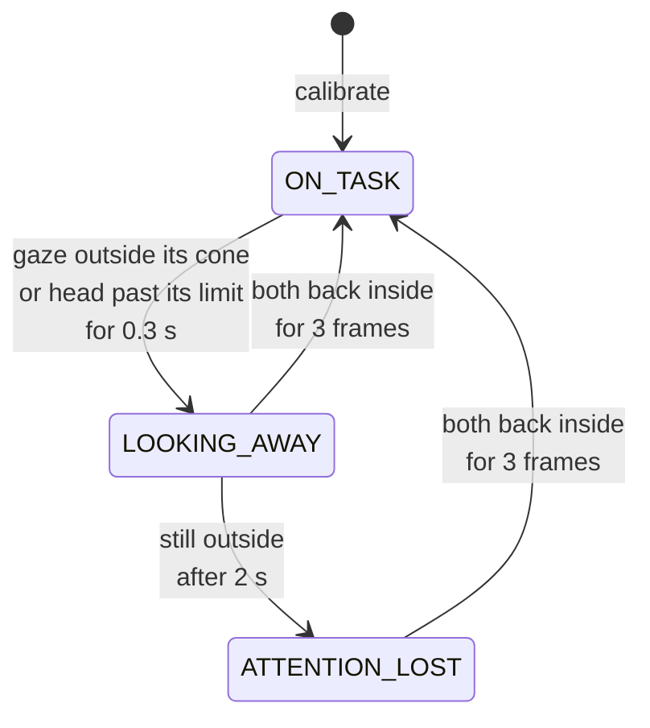

Between the two states shown above sits LOOKING AWAY, where the dwell bar fills:

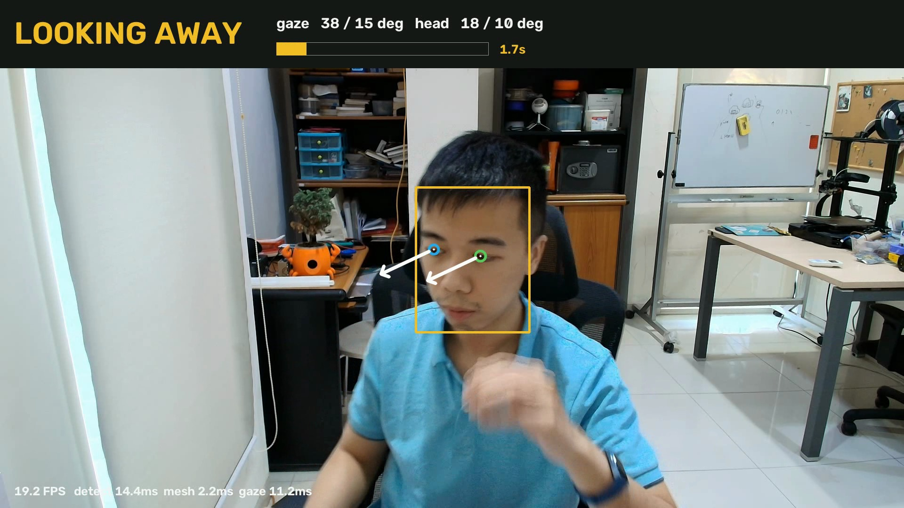

The banner shows each cue against its threshold. On task those are 20 and 15 degrees; once you are away they tighten to 15 and 10, the values needed to get back in. The arrows measure from the calibrated direction, so they shrink to a dot while you are on task and grow as you look away.

## Terms used in this guide

| Term | Meaning |
|---|---|
| Pitch and yaw | Up/down and left/right angles. EyeGaze returns both, in radians |
| Head pose | Orientation of the head itself, as pitch, yaw and roll |
| Camera-relative | Measured in the camera's frame, so any head turn is already included |
| Angular error | Angle between predicted and true gaze direction, the standard gaze metric |
| Cone | The directions counted as on task, given as a half-angle around a centre axis |
| VTCM | The NPU's on-chip memory. A graph too large for it spills to DDR and slows down |

## Before you start

- An IQ-9075 EVK, set up per [Qualcomm's own instructions](https://dragonwingdocs.qualcomm.com/Ubuntu/devices/iq9075-evk/set-up-the-device)
- A USB webcam (UVC). Any recent Logitech works
- A Qualcomm AI Hub account and API token
- A computer with an **arm64** Python 3.10 to 3.13 for the AI Hub client

```bash
python -m venv venv && ./venv/bin/pip install "qai-hub-models" qai-hub
./venv/bin/python -c "import platform; print(platform.machine())"   # must say arm64
```

## Step 1: get the three models from AI Hub

```bash
for m in eyegaze face_det_lite facemap_3dmm; do
  ./venv/bin/qai-hub-models export $m \
      --device "Dragonwing IQ-9075 EVK" \
      --runtime tflite --precision float \
      --skip-profiling --skip-inferencing \
      --output-dir models/_export
done
```

Each lands in `models/_export/<model>-tflite-float/<model>.tflite`. Copy the three files into `models/`.

> **Gotcha: "Something went wrong (an exception was thrown)."** All three models fail the export CLI with only that message. `QAIHM_CLI_VERBOSE_EXCEPTIONS=1` shows the real error, `Model cannot be published: no release assets available`: the wheel ships these models without the `release-assets.yaml` the CLI checks for. Create an empty one per model:
> ```bash
> printf 'models: []\n' > <site-packages>/qai_hub_models/models/<model>/release-assets.yaml
> ```
> Importing the same models from Python never hits this; it is the CLI path only.

EyeGaze also clones an external repository on first load. The CLI prompts for it; a script dies with a bare `OSError: [Errno 22]` because nothing answered. Wrap the load:

```python
from qai_hub_models.utils.asset_loaders import always_answer_prompts
with always_answer_prompts(True):
    from qai_hub_models.models.eyegaze.model import EyeGaze
    model = EyeGaze.from_pretrained()
```

The landmark model needs three basis arrays to turn its output into coordinates. Fetch them once:

```bash
./venv/bin/python scripts/fetch_3dmm_basis.py     # writes models/3dmm/*.npy
```

## Step 2: set up the board

```bash
ssh <your-board>
mkdir -p ~/projects/gaze-attention/{scripts,models,results,test-data}
cd ~/projects/gaze-attention
python3 -m venv venv
./venv/bin/pip install ai-edge-litert opencv-python numpy
```

Install `opencv-python`, not `opencv-python-headless`, or `--display` fails later. Copy `models/` and `scripts/` across with `scp`.

## Step 3: one eye, one number

Start with a single eye through EyeGaze, and read the model's tensors before writing code around it:

```bash
./venv/bin/python scripts/inspect_models.py eyegaze
```

```
=== eyegaze   (10.1 MB on disk)
IN   image              [  1  96 160]        float32
OUT  heatmaps           [ 1  3 34 48 80]     float32  (1.57 MB)
OUT  landmarks          [ 1 34  2]           float32
OUT  gaze_pitchyaw      [1 2]                float32
     total output per inference: 1.57 MB
```

The input has **no channel dimension**: `(1, 96, 160)`, not `(1, 96, 160, 1)`. Preprocessing is resize to 160x96, `cv2.equalizeHist`, divide by 255.

The model was trained on left eyes, so the right eye is **mirrored**: flip its patch, run it, negate the returned yaw. Get this backwards and one eye reports the opposite of the truth.

```python
patch = cv2.equalizeHist(cv2.resize(gray_eye, (160, 96)))
if side == "right":
    patch = np.fliplr(patch).copy()
gaze = model.run((patch.astype(np.float32) / 255.0)[None])["gaze_pitchyaw"].reshape(-1)
if side == "right":
    gaze[1] = -gaze[1]
```

> The zoo's `app.py` mirrors the right eye; the original training repository's webcam script mirrors the left. The dataset loader settles it: the right eye is the mirrored one.

Then run the whole chain on one image to see what each stage finds:

```bash
./venv/bin/python scripts/check_chain.py test-data/portrait-6471976.jpg
```

## Step 4: find the eyes

### Detect the face, and letterbox first

`face_det_lite` takes a 480x640 grayscale image, which is 4:3. Resizing a 16:9 webcam frame straight into that squashes every face, and the boxes get worse. On the same image:

| | detection score | landmarks inside the box |
|---|---|---|
| squashed to 640x480 | 0.681 | 90% |
| letterboxed | **0.925** | **100%** |

```python
scale = min(640 / w, 480 / h)
canvas = np.zeros((480, 640, 3), dtype=frame.dtype)
resized = cv2.resize(frame, (int(w * scale), int(h * scale)))
canvas[pad_y:pad_y + resized.shape[0], pad_x:pad_x + resized.shape[1]] = resized
```

Undo the padding and scale when decoding boxes back to the frame, or every box is offset. This model also converts to grayscale with **scikit-image's** weights (0.2125, 0.7154, 0.0721), not OpenCV's (0.299, 0.587, 0.114). Cheap to get right.

### Landmarks and head pose

`facemap_3dmm` takes a 128x128 crop of the face box and returns 265 numbers: 219 identity coefficients, 39 expression coefficients, three pose angles, two translations and a focal length. `scripts/gaze_common.py` turns them into 68 landmarks and a head pose. Points 36 to 41 are the subject's right eye, 42 to 47 the left.

### Cut the eye patch as a warp, not a crop

This is the step most likely to cost you accuracy without any error message. The model was trained on patches built by an affine transform with a specific geometry:

- the centre is the **midpoint of the two eye corners**, not the mean of the six-point contour
- the patch spans **1.5x the corner-to-corner distance**
- that centre lands at exactly (80, 48), the middle of the 160x96 patch

```python
eye_width = 1.5 * np.linalg.norm(corner_a - corner_b)
scale = 160 / eye_width
transform = centre_at_80_48 @ scale_by(scale) @ translate_to_origin(midpoint)
patch = cv2.equalizeHist(cv2.warpAffine(gray, transform[:2], (160, 96)))
```

The model reads iris position relative to the patch, so a box that merely contains the eye, at the wrong scale or offset, shifts the answer.

## Step 5: two eyes, one direction, and what head pose is for

Turn each eye's pitch and yaw into a direction and average the two:

```python
def gaze_vector(pitch_yaw):                       # camera space: x right, y down
    p, y = pitch_yaw
    return np.array([-np.cos(p) * np.sin(y), np.sin(p), -np.cos(p) * np.cos(y)])

direction = normalise(gaze_vector(right) + gaze_vector(left))
```

The per-eye errors are largely independent, so the mean beats either eye. Expect the two to disagree by about 20 degrees; that is the model's error budget, not a bug.

It is tempting to rotate this direction by the head pose from Stage 2, on the reasoning that an eye model reports gaze relative to the head. **Do not.** The eye patch shows the eye as the camera sees it, head turn included, and EyeGaze reports gaze relative to the camera.

MPIIGaze's original images carry the true gaze direction **and the true head rotation** for every frame, so this can be tested directly. If EyeGaze were head-relative, rotating its output by the *true* head pose would give the best answer. Measured on the board, 2924 eyes:

| | mean angular error | quarter with the most head turn |
|---|---|---|
| **eye-only, as the model returns it** | **16.03 deg** | **16.43 deg** |
| rotated by MPIIGaze's true head pose | 23.44 deg | 32.58 deg |
| rotated by facemap_3dmm's head pose | 17.87 deg | 18.26 deg |

```bash
./venv/bin/python scripts/check_fusion.py
```

A *perfect* head pose makes it worst, twice as bad where the head turns most. The script also fits the model's angles against true gaze and true head angles separately: the head term comes out near zero (-0.07 for pitch, -0.09 for yaw), which is what a camera-relative model looks like.

The same fit puts the gaze term at only **0.44 to 0.54**: EyeGaze **under-reads large angles by about half**. A glance 40 degrees off the screen reads as about 20. That is fine for "is this person looking at the monitor", and it is why the application does not rely on gaze alone (Step 7).

## Step 6: put it on the NPU

One argument:

```python
delegate = load_delegate("/usr/lib/libQnnTFLiteDelegate.so", options={"backend_type": "htp"})
interp = Interpreter(model_path=path, experimental_delegates=[delegate])
```

Measured on the board, governor pinned to `performance`, 50 runs, medians:

| model | parameters | CPU 1 thread | CPU 8 threads | NPU |
|---|---|---|---|---|
| face_det_lite | 878K | 79.86 ms | 11.68 ms | **7.31 ms** |
| facemap_3dmm | 5.42M | 12.43 ms | 2.37 ms | **1.01 ms** |
| eyegaze | 2.58M | 93.09 ms | 15.83 ms | **4.78 ms** |
| all four inferences | | 278.46 ms (3.6 FPS) | 45.71 ms (21.9 FPS) | **17.88 ms (55.9 FPS)** |
| full pipeline | | 288.06 ms (3.5 FPS) | 54.60 ms (18.3 FPS) | **25.02 ms (40.0 FPS)** |

**15.6x on model time, 11.5x end to end.** The gap is host work that does not accelerate: cropping, warping, decoding. It is 3% of the frame on one CPU thread and 29% of it on the NPU.

### The middle model is twice the size and five times faster

`facemap_3dmm` has 5.42M parameters and runs in 1.01 ms; EyeGaze has 2.58M and takes 4.78 ms. The delegate's preparation log explains it:

| model | spill | fill |
|---|---|---|
| face_det_lite | 0.00 MB | 0.00 MB |
| facemap_3dmm | **0.00 MB** | 0.00 MB |
| eyegaze | **5.91 MB** | 5.91 MB |

EyeGaze is a three-stack hourglass holding 48x80 feature maps. It does not fit in VTCM, so every inference moves about 12 MB to and from DDR. Read `spill_bytes` in the delegate's log before blaming a model's size.

### An optimisation that does not pay

EyeGaze returns a 1.57 MB `heatmaps` tensor per eye that no application reads, 99.98% of its output bytes. Re-exporting without it is easy:

| | stock | trimmed | saving |
|---|---|---|---|
| CPU | 94.77 ms | 93.23 ms | 1.6% |
| **NPU** | 4.19 ms | 4.14 ms | **1.2%** |

It cuts VTCM spill by a third, from 5.91 MB to 3.95 MB, and write traffic by nearly half, yet latency barely moves: that traffic overlaps with compute instead of blocking it. Spill points to the slow graph; it does not predict how much faster a fix will make it.

### How often does the detector need to run?

Running the expensive stage less often is the obvious way to buy frame rate. Here every later stage crops from the detector's box, so a stale box feeds a misaligned crop down the whole chain. Measured against the every-frame result on the same frame, on desk footage:

| detector runs | FPS | speedup | mean gaze error introduced | over 10 deg |
|---|---|---|---|---|
| every frame | 34.2 | 1.00x | 0.00 deg | 0% |
| every 2nd | 43.6 | 1.27x | 1.31 deg | 2% |
| every 3rd | 47.9 | 1.40x | 1.93 deg | 4% |
| every 5th | 51.7 | 1.51x | 2.64 deg | 6% |
| every 10th | 55.5 | 1.62x | 3.76 deg | 10% |

Against a 15-degree model, **1.4x for under 2 degrees** (every third frame) is close to free. The answer depends on how much the subject moves, though. The same measurement on a handheld close-up of a fast-moving face:

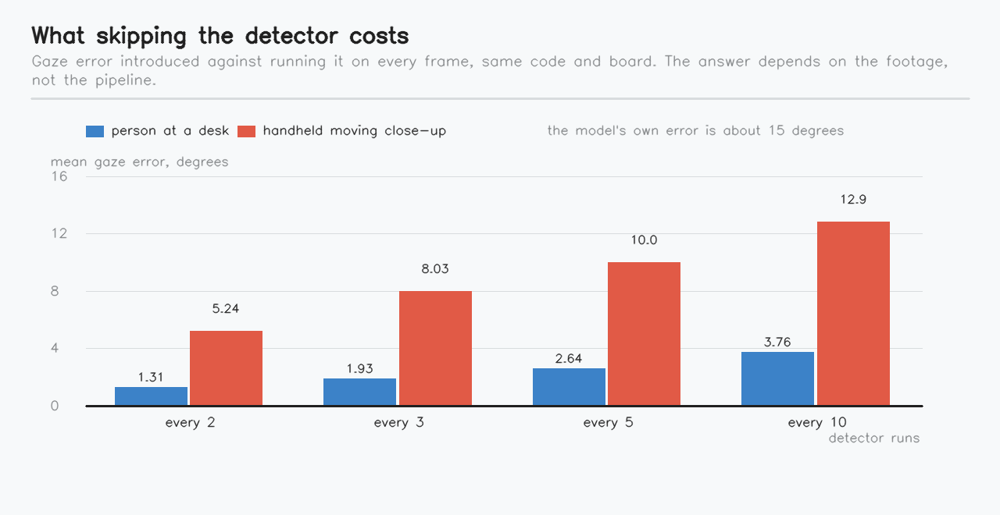

| detector runs | mean gaze error, desk footage | mean gaze error, moving close-up |
|---|---|---|
| every 2nd | 1.31 deg | 5.24 deg |
| every 5th | 2.64 deg | 10.04 deg |
| every 10th | 3.76 deg | **12.90 deg** |

Same code, same board, three to four times the cost.

> **Gotcha: measure on footage like your deployment.** We first measured this on the moving close-up and concluded the detector had to run every frame. A person at a desk, which is what this application watches, barely moves between frames.

## Step 7: calibrate, then watch

```bash
./venv/bin/python scripts/attention.py --source 0 --display --calibrate
```

The window opens on a live preview and waits. Look at whatever you want monitored and press `c`: it averages your gaze direction and the way your head faces over the next three seconds (`--calib-seconds`) and keeps both as the on-task axes. Press `r` to recalibrate at any time.

A key press beats a countdown. With a countdown you race the clock, and if you are still settling when it expires you calibrate on the wrong direction without knowing. **Check the spread the calibration reports**: a steady stare gives about 1.4 degrees; above 15, you moved, and the axis is not worth keeping.

### Two thresholds, sized on real footage

You are off task when **your gaze leaves its cone or your head turns past its limit**. Each cue covers the other's blind spot. Measured on the board over the demo clip, per frame, with each stretch labelled by what the subject was doing:

| | gaze off axis, median / p95 | head turn, median / p95 |
|---|---|---|
| on task, glancing around the monitor | 4.9 / 11.3 deg | 1.7 / 3.9 deg |
| leaning back with a book | 33.2 / 47.7 | 54.9 / 68.4 |
| turned aside, then a phone | 23.2 / 30.3 | 38.6 / 43.0 |
| head on hand, looking away | 40.0 / 46.8 | 23.1 / 29.6 |
| reading in the lap, then a phone | **14.5** / 23.4 | 47.5 / 58.6 |

The last row is why there are two cues: gaze alone would call most of it on task, because EyeGaze under-reads eyes looking down. The defaults, `--cone 20` and `--head-limit 15`, sit well clear of everything on task, and every look-away crosses at least one. Check yours on footage of your own setup; a bigger screen or a closer seat widens the on-task row:

```bash
./venv/bin/python scripts/state_timeline.py --source your-clip.mp4 --csv angles.csv
```

### Three fixes that came from watching it fail

**Smooth the direction.** A 15-degree model crosses a cone boundary constantly frame to frame. An exponential moving average over the direction vector, before the threshold, makes the boundary mean something.

**Make the hysteresis asymmetric.** Leaving the cone starts a timer after a short grace period; clearing it needs several consecutive frames back inside. Without that second half, one lucky frame resets a timer that should have kept running. On a clip of someone asleep at a desk, the fix took the alert from 5 frames to 93.

**Use the right clock.** On a live camera the dwell timer runs on wall time. On a video file it must run on the file's own timeline, or the answer depends on how fast your pipeline is, and CPU and NPU disagree about the same recording.

The overlay uses the model's own output as much as possible: each iris ring comes from EyeGaze's 34 eye landmarks, which come free with every gaze estimate. Both eyes share one arrow displacement, because projecting each eye's arrow separately makes the two point visibly apart even when the gaze is shared.

## Step 8: how much can you trust it?

### It reproduces the published accuracy

Scored on the board's NPU against MPIIGaze's evaluation subset, 576 samples across all 15 subjects:

| | mean angular error |
|---|---|
| measured here | **14.67 deg** |
| published by AI Hub | 16.80 deg |

```bash
./venv/bin/python scripts/eval_mpiigaze.py --backend htp --limit 600
```

MPIIGaze (Zhang et al., CVPR 2015) is licensed CC BY-NC-SA 4.0. The script downloads it from the authors; this repository publishes measurements only.

The deployment is faithful, so 15 degrees is the real figure. At 60 cm it covers a region **31 cm wide**, most of a laptop screen.

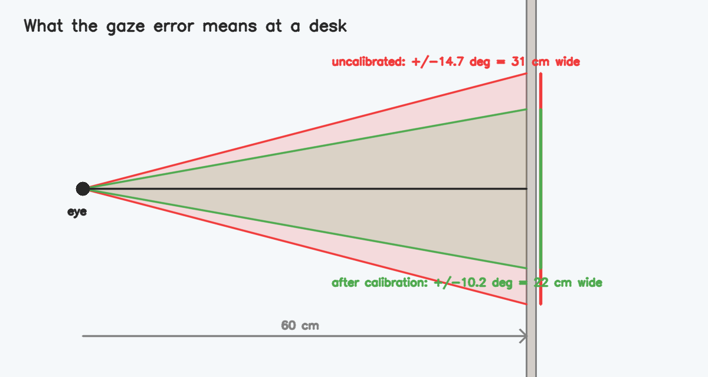

### A third of that error is a fixed bias

Calibration cannot remove noise, but it can remove a constant offset. Subtracting each person's mean residual, which is what the three-second calibration does:

| | mean angular error |
|---|---|
| raw | 14.67 deg |
| after per-person calibration | **10.20 deg** |
| improvement | **31%** |

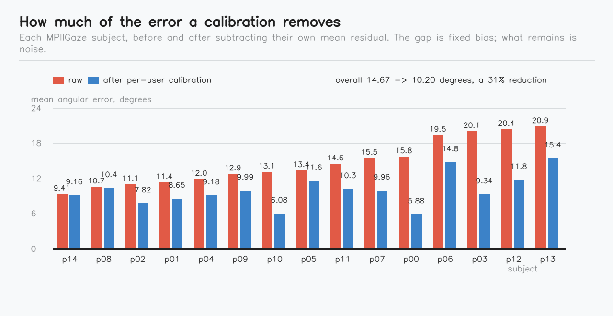

Per-person bias ranged from 3.38 to 18.31 degrees. One subject improved 63%, two only 3%, which argues for calibrating every user instead of shipping one correction.

Ten degrees answers "are you looking at the screen". It does not answer "which icon", and that is why the application classifies into a cone instead of pointing.

### Every model is faithful on the NPU; check the behaviour anyway

Each model fed byte-identical input on CPU and NPU:

| stage | CPU vs NPU |
|---|---|
| eyegaze gaze output | **0.028 deg** |
| facemap_3dmm head pose | 0.011 deg |
| face_det_lite box, at the detected cell | 0.4 px |

Each model is essentially exact, but this pipeline crops from its own intermediate results. A 0.4 pixel difference in the first stage becomes a different face crop, which moves the landmarks, which moves the eye patches: on one image the two backends end up about **5 degrees** apart.

Whether that matters depends on what reads the number. A raw per-frame direction fed into a threshold lands on different sides of it. Smoothed first, as in Step 7, the difference mostly disappears: over the 133-second demo clip with the same calibration, CPU and NPU reported **1581 and 1550 alert frames**, catching every lapse and differing by about a second at their edges.

## Adapting this for in-cabin driver monitoring

The same pipeline is the standard shape of a driver monitoring system, and EyeGaze's own documentation lists that use first. What changes:

- **Camera placement.** A driver camera sits below or beside the line of sight, so the calibrated axis is far from straight ahead. Calibrate in the seat.
- **Lighting.** Cabins run from direct sun to full dark, which is why production systems use infrared illumination and IR-sensitive sensors. MPIIGaze is daylight visible-light data, so expect worse accuracy at night.
- **A wider cone, a shorter dwell.** The road is a large target, and two seconds matters more at speed than at a desk.
- **Glasses and sunglasses.** Reflections and tint break eye patches long before they break face detection.

This is not a certified driver monitoring system, and it makes no claim against the regulations those are validated for. Use it to understand the pipeline, not in a vehicle.

## Results

Every number in this guide came from a run on the board. The raw data and demo videos are in the repository's `results/` folder:

- `bench_log.csv`: per-model and pipeline timings
- `sched_cost.csv` and `sched_cost_closeup.csv`: the detector-scheduling trade, desk and fast-moving footage
- `mpiigaze_eval.csv` and `mpiigaze_eval_calibration.csv`: per-sample error and per-person bias
- `timeline_sample03.csv`: per-frame gaze and head angles behind the threshold table
- `sample03-attention.mp4`: the full demo clip through the application
- `hero-pipeline.mp4`: the four stages playing side by side

## Project structure

```
models/                  the three .tflite files, plus the 3DMM basis arrays
scripts/
  gaze_common.py         models, decoding, eye patches, gaze and head directions
  attention.py           the application
  run_live.sh            launch it on the board's own monitor, for filming
  stop_live.sh           stop it cleanly, so the recording stays playable
  fetch_3dmm_basis.py    download the landmark model's basis arrays
  inspect_models.py      input and output tensors of each model
  check_chain.py         run the chain on one image
  check_fusion.py        is EyeGaze head- or camera-relative? scored against ground truth
  verify_backends.py     CPU vs NPU, per model, identical inputs
  bench.py               per-stage and pipeline timings
  spill_probe.py         VTCM spill per model
  export_trimmed.py      re-export EyeGaze without its unused heatmaps output
  bench_trim.py          what dropping that output saves
  sched_cost.py          what skipping the detector costs
  state_timeline.py      attention state and per-frame angles over a clip
  eval_mpiigaze.py       accuracy and the calibration test
  stage_videos.py        per-stage videos and stills (stage_render.py lays them out)
  pipeline_strip.py      the four-stage overview image
  hero_pipeline.py       the four stages as one 4:3 clip
  doc_figures.py         the scheduling and calibration charts
  error_cone.py          an angular error drawn at a viewing distance
  render_diagrams.py     the mermaid diagrams as PNG
  debug_crops.py, compare_landmarks.py, sweep_crop.py    development diagnostics
results/                 measurements and the annotated demo videos
```

## Troubleshooting

**`Something went wrong (an exception was thrown)` from the export CLI.** Step 1: set `QAIHM_CLI_VERBOSE_EXCEPTIONS=1`, then create the empty `release-assets.yaml`.

**`OSError: [Errno 22]` loading EyeGaze from a script.** It is asking to clone a repository. Use `always_answer_prompts(True)`.

**The first NPU inference takes seconds.** One-time graph preparation when the delegate loads, once per process, with a wall of `Starting stage:` logs.

**One eye reports the opposite direction from the other.** Flip the right eye's patch and negate its yaw (Step 3).

**Boxes are offset, or faces at the edges are missed.** Letterboxing, or undoing it (Step 4).

**Gaze is wildly wrong on stylised photographs.** MPIIGaze is evenly lit, low-resolution webcam imagery; studio portraits with hard side light are far outside it. Test on footage like your deployment.

**The webcam sits at 10 FPS.** Request MJPG before setting the resolution.

## Going further

- Replace the frozen box between detector runs with a tracker, and see whether the scheduling trade in Step 6 improves
- Implement MPIIGaze's full normalisation warp, which uses 3D eye position and head pose to remove the appearance change from head rotation, and measure it against the 2D warp used here
- Correct EyeGaze's under-reading with a per-user gain learned during calibration, and see whether gaze alone can then catch the phone in the lap
- Add a second person. Nothing in the pipeline is single-face except the line that picks `faces[0]`

## Back to the night shift

Put this monitor in front of the operator from the opening. It can tell you that they looked away from the panel at 03:12, for how long, and how often across the shift. It cannot tell you which alarm they read before they looked away. That line comes from a measurement, 15 degrees before calibration and 10 after, and it holds for any application built on this model: sorting attention into a region the size of a screen works, and pointing within it does not.

The lessons carry over to any pipeline where one model feeds another:

- **Find out what frame each model's output is in before you combine them.** Here, an eye model that seemed obviously head-relative was camera-relative, and only a test with ground-truth head pose showed it.
- **Every model matching its reference does not mean the pipeline does.** Each model here matched its CPU reference to a fraction of a degree while the chain differed by five. Check behaviour at the decision, on the backend you ship.
- **Measure on data that looks like the deployment.** The detector-scheduling advice reversed between a handheld close-up and a person at a desk.
- **When one signal has a blind spot, add one that fails differently.** Gaze misses eyes looking down; the head does not.
