# Eye gaze on the Dragonwing IQ-9075: three NPU models, one attention monitor

Chain a face detector, a facial landmark model and a gaze estimator on the Dragonwing
IQ-9075 NPU, then build an operator attention monitor on top of them. Four NPU
inferences per frame at 38 FPS on 1080p video, and an honest account of what a
15-degree gaze model can and cannot be trusted to do.

**Author:** Samuel Alexander  
**Target:** Qualcomm Dragonwing IQ-9075 EVK  
**Models:** [EyeGaze](https://aihub.qualcomm.com/models/eyegaze),
[Lightweight-Face-Detection](https://aihub.qualcomm.com/models/face_det_lite) and
[Facial-Landmark-Detection](https://aihub.qualcomm.com/models/facemap_3dmm), all
BSD-3-Clause, all compiled through Qualcomm AI Hub  
**Difficulty:** Intermediate. Assumes you have deployed one model to this board before  
**Time:** About 3 hours, including cloud compile jobs and a dataset download  
**Repository:** https://github.com/SamuelAlexander/dragonwing-gaze-attention

If you have already run [a single model on this board](https://dragonwingdocs.qualcomm.com/tutorial),
you know the shape of it: export from AI Hub, copy a `.tflite` across, load the QNN
delegate, done. This guide is about what changes when one model is not enough.

## Why anyone watches where people are looking

An operator misses an alarm while reading their phone. A driver drifts out of a lane in
the two seconds their eyes were on the console. In both cases someone was present. Nobody
was **attending**, and presence is the easy thing to measure.

Attention is harder, and the obvious fixes do not work. A person watching the camera just
moves the problem. Streaming video to a server carries faces off the premises, which is a
privacy problem and often a legal one. The useful version runs **on the device, with
nothing leaving the room**, which is what a board with an NPU is for.

So: a monitor that learns where someone is supposed to be looking, watches whether they
still are, and alerts when they have not been for long enough to matter. Entirely on an
IQ-9075, at 38 FPS.

One caveat up front, because it shapes everything. This gaze model's mean error is near
**15 degrees**. That rules out the applications people reach for first (which button, which
word) and leaves a narrower one that is still worth building: **is this person attending to
the right thing, yes or no**. Most of the engineering below is about respecting that line.

## See it in action

The monitor watches whether someone is still looking at the thing they are supposed to
be looking at. It learns that direction from a three second calibration, then reports
how far off it they are, and raises an alert if they stay away.

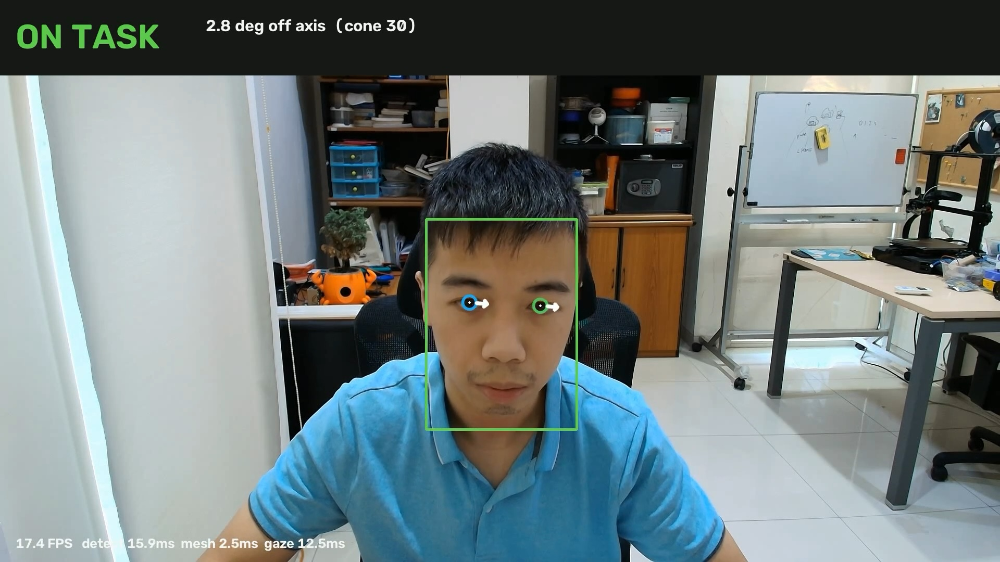

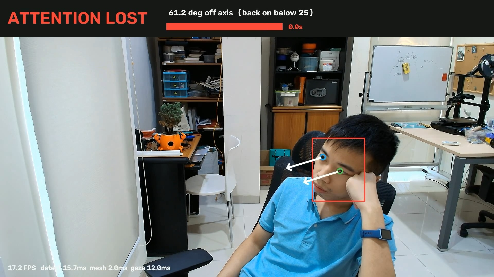

Same clip, same board, seconds apart. The full annotated videos are in
[`results/`](results/).

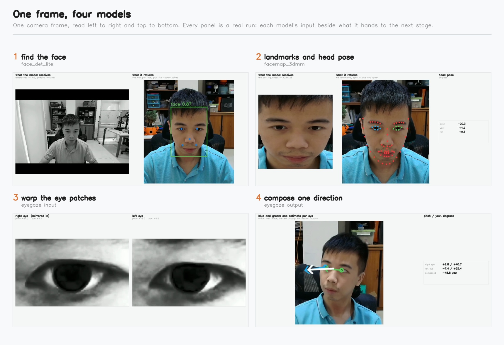

## Why this needs three models

EyeGaze does not take a photograph of a person. It takes a **96x160 grayscale image of
one eye**, and it returns where that eye is pointing. Nothing in the model finds a face,
finds an eye, or crops one. That is your job, and it is most of the work.

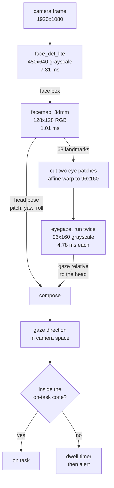

Four NPU inferences per frame. All three models are Qualcomm's own and all three are
BSD-3-Clause, which is a rarer thing than it sounds when you are chaining models.

Each figure below is a single frame of a real run, showing what every stage receives and
what it hands on. All four play together in
[`results/eye-gaze-pipeline.mp4`](results/eye-gaze-pipeline.mp4) if you want to watch the
numbers move.

### Stage 1: find the face

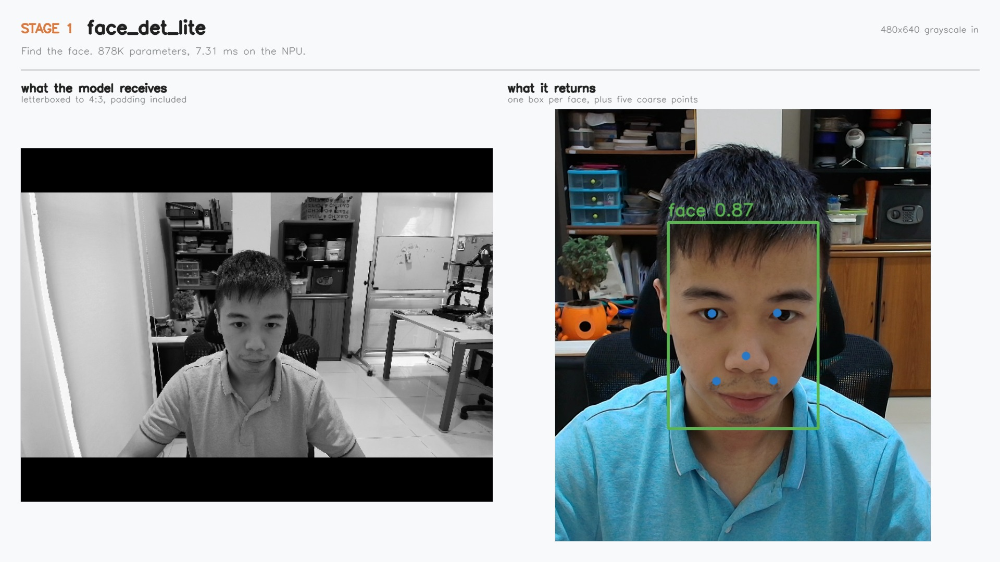

The left panel is the actual tensor, black padding included. That padding is the point:
the model wants 4:3 and a webcam gives 16:9, so the frame is letterboxed rather than
squashed. [Step 4](#detect-the-face-and-letterbox-first) has the numbers on why.

### Stage 2: landmarks and head pose

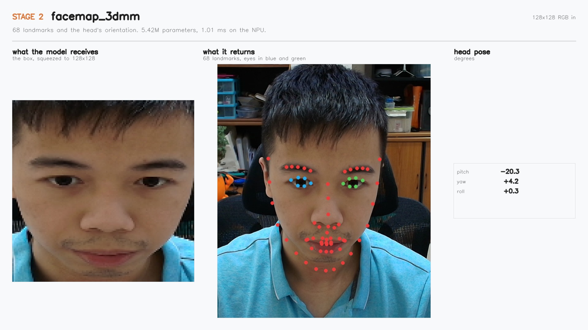

The visible pixelation on the left is real. A face box is cropped and squeezed to 128x128,
which is all this model needs to place 68 points back on the full-resolution frame and
report which way the head is turned.

### Stage 3: cut the eye patches

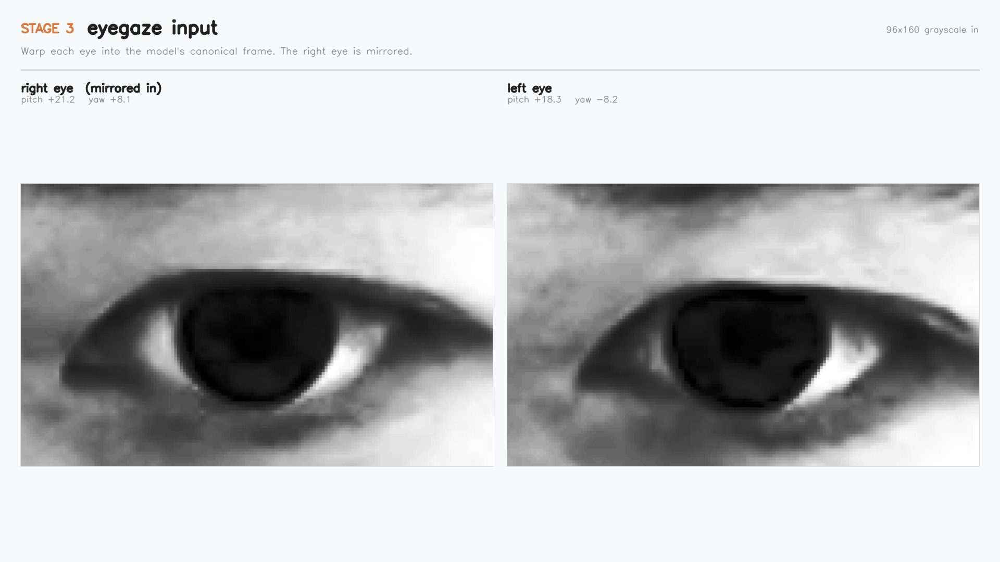

This is the step most likely to cost you accuracy quietly. Both patches are warps, not
crops: the eye centre lands at the same place at the same scale every time, which is the
geometry the model was trained on. The right eye is mirrored on the way in and its yaw
negated on the way out.

### Stage 4: two eyes, one direction

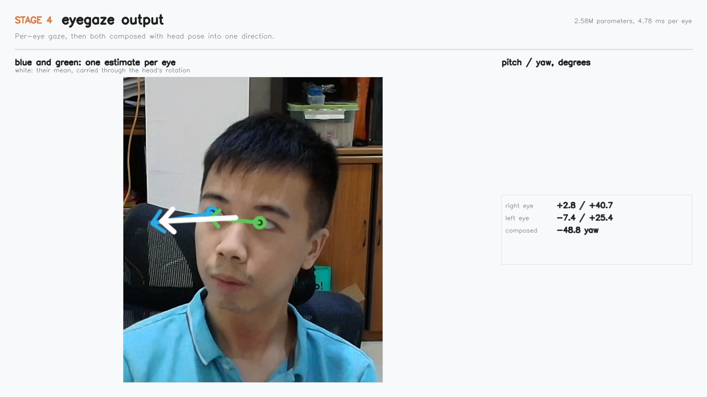

Blue and green are the two per-eye estimates. They disagree, and should: each carries
about 15 degrees of error, so two independent estimates differ by roughly 20 degrees.
White is their mean, carried through the head's rotation. Averaging is the cheapest
accuracy available.

### Stage 5: turn a direction into a decision

A direction is not yet an answer. The application adds three things, and each exists
because of a measurement rather than a preference:

| what | why |
|---|---|
| **A calibrated axis**, learned in three seconds | Roughly a third of this model's error is a fixed per-user offset. Calibration subtracts it |
| **A cone, not a point**, 30 degrees by default | The residual error is 10 degrees. A 27 inch monitor at 60 cm subtends about the same. Sized to the target, not to taste |
| **A dwell timer with hysteresis** | A single frame from a 15-degree model crosses any boundary constantly. Smoothing plus asymmetric thresholds turn a noisy signal into a stable state |

The result is three states with one transition rule each:

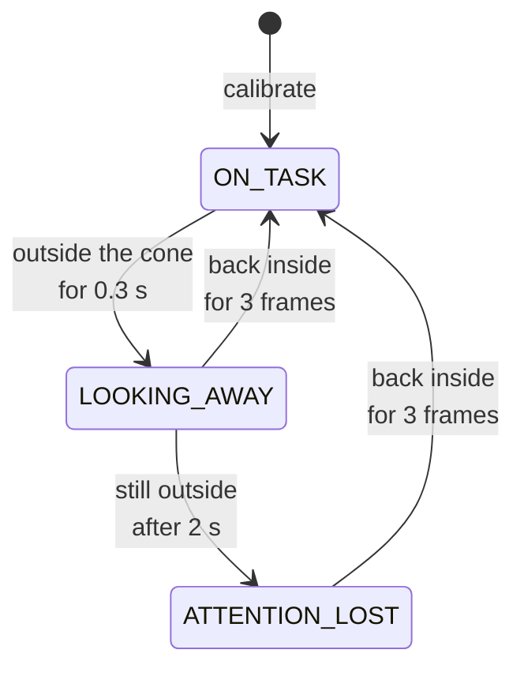

Which looks like this, in order. Watch the dwell bar rather than the banner: it is the
part that turns a noisy per-frame angle into a decision worth acting on.


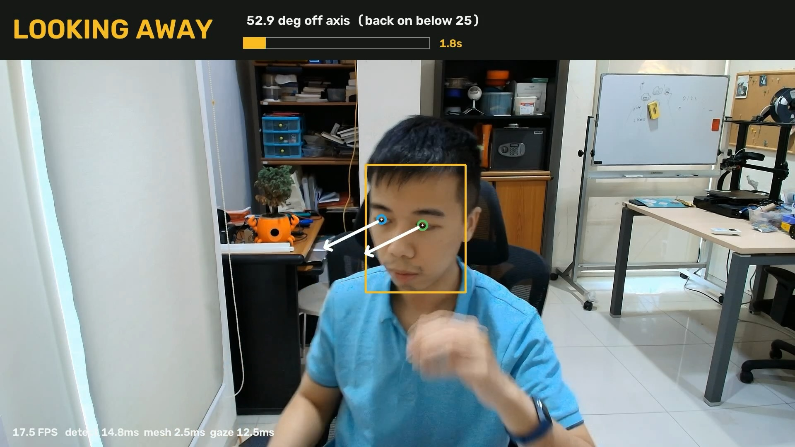


Note the readout changes with the state. On task it shows the cone, 30 degrees. Once
outside it shows the tighter threshold to get back in, 25 degrees, because the hysteresis
means those are different numbers and hiding that would make the overlay look broken.

[Step 7](#step-7-calibrate-then-watch) builds it. What matters here is that every one of
those numbers came from watching the thing fail first.

The middle model earns its place twice. It gives the 68 facial landmarks that define
where to cut the eye patches, and it gives **head pose**, which you need for a reason
that is easy to miss:

> EyeGaze reports where the eye points **relative to the head**. Someone whose eyes are
> centred in their sockets is looking straight ahead of their face, which tells you
> nothing about where they are looking in the room until you know which way the face is
> turned.

Where a person is actually looking is the eye direction carried through the head's own
rotation. That composition is the heart of this guide.

## Terms used in this guide

| Term | Meaning |
|---|---|
| Pitch and yaw | Up/down and left/right angles. EyeGaze returns both, in radians |
| Head pose | Orientation of the head itself, as pitch/yaw/roll |
| Eye patch | The cropped, scaled, contrast-equalised image of one eye the model expects |
| Angular error | Angle between predicted and true gaze direction, in degrees. The standard gaze metric |
| Cone | The set of directions counted as "on task", given as a half-angle from a centre axis |
| Letterbox | Resizing while preserving aspect ratio and padding the remainder, instead of stretching |
| VTCM | The NPU's on-chip memory. A graph too large for it spills to DDR and slows down |

## What you'll build

By the end you will have a working attention monitor: it calibrates against whatever the
camera is pointed at, tracks a person's gaze at 37.8 FPS on 1080p video on the NPU, and
escalates through an on-screen state and an audible alert when attention lapses. You will
also have measured how accurate it actually is, which turns out to be the part that
decides how you are allowed to use it.

## Before you start

- An IQ-9075 EVK, set up per
  [Qualcomm's own instructions](https://dragonwingdocs.qualcomm.com/Ubuntu/devices/iq9075-evk/set-up-the-device)
- A USB webcam (UVC). Any recent Logitech works
- A Qualcomm AI Hub account and API token
- A computer with an **arm64** Python 3.10 to 3.13 for the AI Hub client

```bash
python -m venv venv && ./venv/bin/pip install "qai-hub-models" qai-hub
./venv/bin/python -c "import platform; print(platform.machine())"   # must say arm64
```

## Step 1: get the three models from AI Hub

```bash
for m in eyegaze face_det_lite facemap_3dmm; do
  ./venv/bin/qai-hub-models export $m \
      --device "Dragonwing IQ-9075 EVK" \
      --runtime tflite --precision float \
      --skip-profiling --skip-inferencing \
      --output-dir models/_export
done
```

Each lands in `models/_export/<model>-tflite-float/<model>.tflite`. Copy the three files
into `models/`.

> **Gotcha: "Something went wrong (an exception was thrown)."**
> All three of these models fail the export CLI with that message and nothing else. Set
> `QAIHM_CLI_VERBOSE_EXCEPTIONS=1` to see the real error, which is
> `Model cannot be published: no release assets available`. The wheel ships these models
> without the `release-assets.yaml` the CLI validates against. Create an empty one per
> model and the export runs:
> ```bash
> printf 'models: []\n' > <site-packages>/qai_hub_models/models/<model>/release-assets.yaml
> ```
> Importing the same models directly from Python does not hit this at all, so it is a
> property of the CLI path, not of the models.

EyeGaze also needs an external repository cloned on first load. From the CLI it prompts
you; from a script it dies with a bare `OSError: [Errno 22]` because nothing answered.
Wrap the load:

```python
from qai_hub_models.utils.asset_loaders import always_answer_prompts
with always_answer_prompts(True):
    from qai_hub_models.models.eyegaze.model import EyeGaze
    model = EyeGaze.from_pretrained()
```

The landmark model needs three basis arrays to turn its output into coordinates. Fetch
them once:

```bash
./venv/bin/python scripts/fetch_3dmm_basis.py     # writes models/3dmm/*.npy
```

## Step 2: set up the board

```bash
ssh <your-board>
mkdir -p ~/projects/gaze-attention/{scripts,models,results,test-data}
cd ~/projects/gaze-attention
python3 -m venv venv
./venv/bin/pip install ai-edge-litert opencv-python numpy
```

Install `opencv-python`, not `opencv-python-headless`, or `--display` will fail later.
Copy your `models/` and `scripts/` across with `scp`.

## Step 3: one eye, one number

Start with the smallest thing that works: a single eye crop through EyeGaze. Read the
model's tensors before writing any code around it.

```bash
./venv/bin/python scripts/inspect_models.py eyegaze
```

```
=== eyegaze   (10.1 MB on disk)
IN   image              [  1  96 160]        float32
OUT  heatmaps           [ 1  3 34 48 80]     float32  (1.57 MB)
OUT  landmarks          [ 1 34  2]           float32
OUT  gaze_pitchyaw      [1 2]                float32
     total output per inference: 1.57 MB
```

Then run the whole chain on one image, which prints what each stage found:

```bash
./venv/bin/python scripts/check_chain.py test-data/portrait-6471976.jpg
```

Three things to notice.

**The input has no channel dimension.** It is `(1, 96, 160)`, not `(1, 96, 160, 1)`.

**Preprocessing is fixed and small:** resize to 160x96, `cv2.equalizeHist`, divide by 255.

**One eye is mirrored.** The model was trained on left eyes. For the right eye you flip
the patch horizontally, run it, then negate the returned yaw to put it back into the
original frame. Get this backwards and one eye reports the opposite of the truth.

```python
patch = cv2.equalizeHist(cv2.resize(gray_eye, (160, 96)))
if side == "right":
    patch = np.fliplr(patch).copy()
gaze = model.run((patch.astype(np.float32) / 255.0)[None])["gaze_pitchyaw"].reshape(-1)
if side == "right":
    gaze[1] = -gaze[1]
```

> The zoo's `app.py` mirrors the right eye; the original training repository's webcam
> script mirrors the left. They cannot both be right. The dataset loader settles it: the
> right eye is the mirrored one.

## Step 4: find the eyes

Now the part EyeGaze does not do for you.

### Detect the face, and letterbox first

`face_det_lite` takes a 480x640 grayscale image, which is 4:3. Your webcam is almost
certainly 16:9. If you resize straight into the model's shape you squash every face
horizontally, and the detector's boxes get noticeably worse.

Padding instead of stretching, on the same image:

| | detection score | landmarks inside the box |
|---|---|---|
| squashed to 640x480 | 0.681 | 90% |
| letterboxed | **0.925** | **100%** |

```python
scale = min(640 / w, 480 / h)
canvas = np.zeros((480, 640, 3), dtype=frame.dtype)
resized = cv2.resize(frame, (int(w * scale), int(h * scale)))
canvas[pad_y:pad_y + resized.shape[0], pad_x:pad_x + resized.shape[1]] = resized
```

Remember to undo the padding and the scale when you decode boxes back to frame
coordinates, or every box will be offset.

One more detail: this model's own preprocessing uses **scikit-image's** grayscale weights
(0.2125, 0.7154, 0.0721), not OpenCV's (0.299, 0.587, 0.114). Small difference, free to
get right.

### Landmarks and head pose

`facemap_3dmm` takes a 128x128 crop of the face box and returns 265 numbers: 219 identity
coefficients, 39 expression coefficients, three pose angles, two translations and a focal
length. `scripts/gaze_common.py` turns those into 68 landmarks and a head pose. Points 36
to 41 are the subject's right eye, 42 to 47 the left.

### Cut the eye patch as a warp, not a crop

This is the step most likely to quietly cost you accuracy. The model was trained on
patches built by an affine transform with a specific geometry:

- the centre is the **midpoint of the two eye corners**, not the mean of the six-point
  contour
- the patch spans **1.5x the corner-to-corner distance**
- that centre lands at exactly (80, 48), the middle of the 160x96 patch

```python
eye_width = 1.5 * np.linalg.norm(corner_a - corner_b)
scale = 160 / eye_width
transform = centre_at_80_48 @ scale_by(scale) @ translate_to_origin(midpoint)
patch = cv2.equalizeHist(cv2.warpAffine(gray, transform[:2], (160, 96)))
```

A rectangular crop that merely contains the eye is not equivalent. The model reads iris
position relative to the patch, so a patch at the wrong scale or offset shifts the answer.

## Step 5: fuse head pose with eye gaze

Two angles from the eye, three from the head, one direction out:

```python
def fuse(head_pose, eye_gaze):
    g_head = pitchyaw_to_vector(*eye_gaze)        # eye direction, in head coordinates
    return head_rotation_camera(head_pose) @ g_head
```

The guide turns on that one matrix, and it is easy to get wrong silently. The landmark
model builds its rotation in **its own model space** (y-up) and flips to image space at
the end. Apply that rotation straight to a gaze vector already in camera convention and
the answer looks plausible and is wrong:

```python
P = np.diag([1.0, -1.0, -1.0])                    # the mesh's model-to-image flip

def head_rotation_camera(head_pose):
    return (P @ rotation_from_pose(*head_pose) @ P).T
```

Two checks are worth building before you trust it. The first is free: **head pitch and eye
pitch must move the fused direction the same way.** If tilting the head down and rolling
the eyes down push the result in opposite directions, the composition is inverted.

The second needs ground truth. MPIIGaze's original images carry a 3D gaze target and 3D
eye centres in camera coordinates, so the true direction per eye is known, which lets you
score the whole pipeline rather than just the model:

| | mean angular error |
|---|---|
| ignore head pose entirely | 15.29 deg |
| rotation applied naively | **17.48 deg** |
| **rotation conjugated as above** | **14.61 deg** |

The naive version is *worse than not using head pose at all*, and only 0.68 degrees
separates the correct version from ignoring it, on a dataset where subjects sit facing a
laptop and barely turn their heads. On a subject who actually turns away, which is the
whole point of an attention monitor, it matters far more.

```bash
./venv/bin/python scripts/check_fusion.py --limit 400
```

> **Gotcha: a wrong rotation looks like a bad camera position.** Before this was fixed,
> calibration consistently landed about 45 degrees below the camera and it read as a
> plausible "the webcam sits above the monitor" effect. After the fix, the same person
> looking at the same monitor calibrates to 8 degrees off the camera axis with a **1.3
> degree** spread.

Run both eyes and average the results. The per-eye errors are largely independent, so the
mean is a better estimate than either, for free.

A useful sanity check while building this: the angle between the two eyes' fused
directions. It will not be zero. For a model with roughly 15 degrees of error, two
independent estimates should differ by around 20 degrees on average, and that is what you
see. If you find yourself hunting for a bug because the eyes disagree by 25 degrees, the
model's own error budget probably already explains it.

## Step 6: put it on the NPU

One argument:

```python
delegate = load_delegate("/usr/lib/libQnnTFLiteDelegate.so", options={"backend_type": "htp"})
interp = Interpreter(model_path=path, experimental_delegates=[delegate])
```

Measured on the board, governor pinned to `performance`, 50 runs, medians:

| model | parameters | CPU 1 thread | CPU 8 threads | NPU |
|---|---|---|---|---|
| face_det_lite | 878K | 79.86 ms | 11.68 ms | **7.31 ms** |
| facemap_3dmm | 5.42M | 12.43 ms | 2.37 ms | **1.01 ms** |
| eyegaze | 2.58M | 93.09 ms | 15.83 ms | **4.78 ms** |
| all four inferences | | 278.46 ms (3.6 FPS) | 45.71 ms (21.9 FPS) | **17.88 ms (55.9 FPS)** |
| full pipeline | | 288.06 ms (3.5 FPS) | 54.60 ms (18.3 FPS) | **25.02 ms (40.0 FPS)** |

**15.6x on model time, 11.5x end to end.** The gap between those two numbers is host work
that does not accelerate: cropping, warping, decoding. It is 3% of the frame on one CPU
thread and 29% of it on the NPU, which is the usual result of making the model fast.

### The middle model is twice the size and five times faster

`facemap_3dmm` has 5.42M parameters and runs in 1.01 ms. EyeGaze has 2.58M and takes
4.78 ms. Parameter count is not the story here. The delegate's own preparation log is:

| model | spill | fill |
|---|---|---|
| face_det_lite | 0.00 MB | 0.00 MB |
| facemap_3dmm | **0.00 MB** | 0.00 MB |
| eyegaze | **5.91 MB** | 5.91 MB |

EyeGaze is a three-stack hourglass holding 48x80 feature maps, and it does not fit in
VTCM, so every inference moves about 12 MB to and from DDR. That is where the time goes.
Read `spill_bytes` in the delegate's log before assuming a model is slow because it is
big.

### A tempting optimisation that is not worth doing

EyeGaze returns a 1.57 MB `heatmaps` tensor per eye that no application reads: 99.98% of
its output bytes are discarded. Re-exporting without that output is easy, and it does
almost nothing.

| | stock | trimmed | saving |
|---|---|---|---|
| CPU | 94.77 ms | 93.23 ms | 1.6% |
| **NPU** | 4.19 ms | 4.14 ms | **1.2%** |

It does cut VTCM spill by a third, from 5.91 MB to 3.95 MB, and write traffic by nearly
half. Latency barely moves anyway, because that traffic overlaps with compute rather than
blocking in front of it. Spill tells you **which** graph is slow; it does not linearly
predict **how much**. Worth knowing before you spend a day on a similar idea.

## Step 7: calibrate, then watch

```bash
./venv/bin/python scripts/attention.py --source 0 --display --calibrate
```

The window opens on a live preview and waits. Press `c` when you are looking at whatever
you want monitored; it averages the fused gaze over the next three seconds
(`--calib-seconds`) and keeps that as the on-task axis. Press `r` at any time to
recalibrate without restarting.

Waiting for a key rather than counting down is not a detail. A countdown makes you race
the clock, and if you are still settling when it expires you calibrate on the wrong
direction and do not discover it until you inspect the axis afterwards. **Check the
spread the calibration reports**: a steady stare gives about 1.3 degrees, and anything
above 15 means you were not holding still and the axis is not worth keeping.

### Sizing the cone to the thing being watched

The default cone is 30 degrees, and that number comes from geometry rather than taste. A
27 inch monitor at 60 cm subtends roughly **plus or minus 27 degrees** horizontally, so a
25 degree cone reports "looking away" when the operator glances at the corner of their own
screen. Measured on a desk recording, looking anywhere on the monitor stays under about
30 degrees while a genuine distraction sits at 45 to 55, which leaves a comfortable gap:

| | angle off the calibrated axis |
|---|---|
| anywhere on the monitor | 0 to 30 deg |
| looking at a phone | 45 to 55 deg |

Set the cone from your own display's angular size, not from a default.

### Reading the overlay

Each eye gets a ring fitted to **EyeGaze's own iris landmarks**, the 34-point output that
would otherwise be thrown away, and an arrow whose length is the projection of the gaze
direction onto the image plane. That length is `sin(angle off the camera axis)`, so it
shrinks to nothing when the subject looks straight down the lens and grows as they turn
away, which makes small movements visible while still on task.

Both eyes are drawn with the **same** displacement. Projecting each eye's arrow separately
through a perspective transform is geometrically correct and looks broken: the two irises
sit on opposite sides of the image centre, so a gaze toward the lens pushes each arrow
radially outward in a different direction, and the eyes appear to disagree.

Three things make the difference between a demo and something usable, and all three came
out of watching it fail:

**Smooth the direction, not just the state.** A model with 15 degrees of error crosses a
cone boundary constantly. An exponential moving average over the direction vector is what
makes the boundary mean anything.

**Make the hysteresis asymmetric.** Leaving the cone starts a timer after a short grace
period; clearing it requires several consecutive frames back inside. Without that second
half, one lucky frame resets a dwell timer that should have kept running. In testing, a
clip of someone asleep at their desk reported 5 alert frames. With the fix, 93.

**Use the right clock.** A dwell timer on a live camera runs on wall time. On a video
file it must run on the file's own timeline, or the same clip gives different answers
depending on how fast your pipeline happens to be, and CPU and NPU disagree about a
recording.

### How often does the detector really need to run?

The obvious way to buy frame rate in a multi-model pipeline is to run the expensive stage
less often. Every later stage crops from the detector's box, so a stale box does not just
delay detection, it feeds a misaligned crop down the whole chain. The question is how much
that actually costs, measured against the every-frame result on the same frame:

| detector runs | FPS | speedup | mean gaze error introduced | over 10 deg |
|---|---|---|---|---|
| every frame | 26.5 | 1.00x | 0.00 deg | 0% |
| every 2nd | 35.9 | 1.37x | 0.92 deg | 1% |
| every 3rd | 40.2 | 1.53x | 1.37 deg | 2% |
| every 5th | 44.8 | 1.71x | 1.85 deg | 3% |
| every 10th | 49.4 | 1.88x | 2.94 deg | 7% |

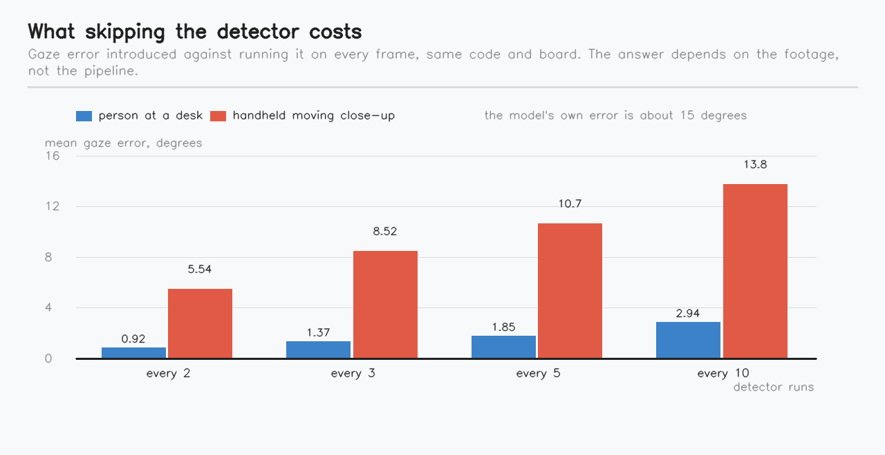

**1.71x for under 2 degrees is a good trade**, against a model whose own error is about
15 degrees. Running the detector every third to fifth frame is close to free.

That answer is not a property of the pipeline, though. It is a property of **how much the
subject moves**, and it is worth seeing how sharply it changes. The same measurement on a
handheld close-up clip, with a subject moving quickly and filling the frame:

| detector runs | mean gaze error, desk footage | mean gaze error, moving close-up |
|---|---|---|
| every 2nd | 0.92 deg | 5.54 deg |
| every 5th | 1.85 deg | 10.69 deg |
| every 10th | 2.94 deg | **13.77 deg** |

Same code, same board, a 4.7x difference in what skipping costs. On the fast-moving clip,
skipping to every tenth frame adds about as much error as the model already has.

> **Gotcha: pick this number on footage that looks like your deployment.** We first
> measured it on the moving close-up and concluded the detector must run every frame.
> That conclusion was an artefact of unrepresentative test data. A person sitting at a
> desk, which is what this application actually watches, barely moves between frames.

## Step 8: how much can you trust it?

This is the section that decides what you are allowed to build.

### It reproduces the published accuracy

Scored on the board, NPU, against MPIIGaze's own evaluation subset, 576 samples spread
evenly across all 15 subjects:

| | mean angular error |
|---|---|
| measured here | **14.67 deg** |
| published by AI Hub | 16.80 deg |

```bash
./venv/bin/python scripts/eval_mpiigaze.py --backend htp --limit 600
```

MPIIGaze (Zhang et al., CVPR 2015) is licensed CC BY-NC-SA 4.0. The script downloads it
from the authors; this repository publishes measurements only, not the data.

So the deployment is faithful. That is the good news and also the problem, because 15
degrees is a lot. At a 60 cm viewing distance it is a region **31 cm wide**, which is
most of a laptop screen.

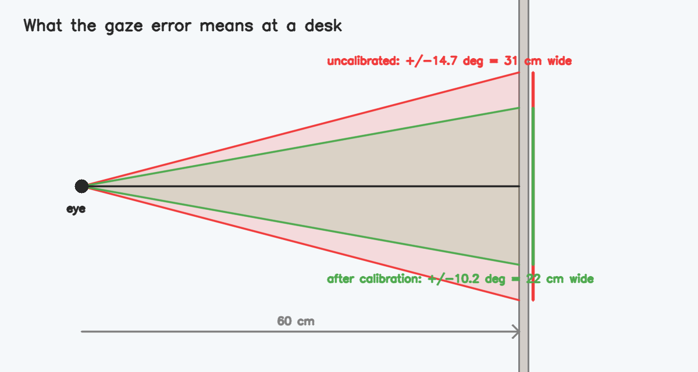

### Most usefully, a third of that error is a fixed bias

A short calibration cannot remove noise, but it can remove a constant offset. Simulating
exactly what the three second calibration does, by subtracting each person's mean
residual:

| | mean angular error |
|---|---|
| raw | 14.67 deg |
| after per-person calibration | **10.20 deg** |
| improvement | **31%** |

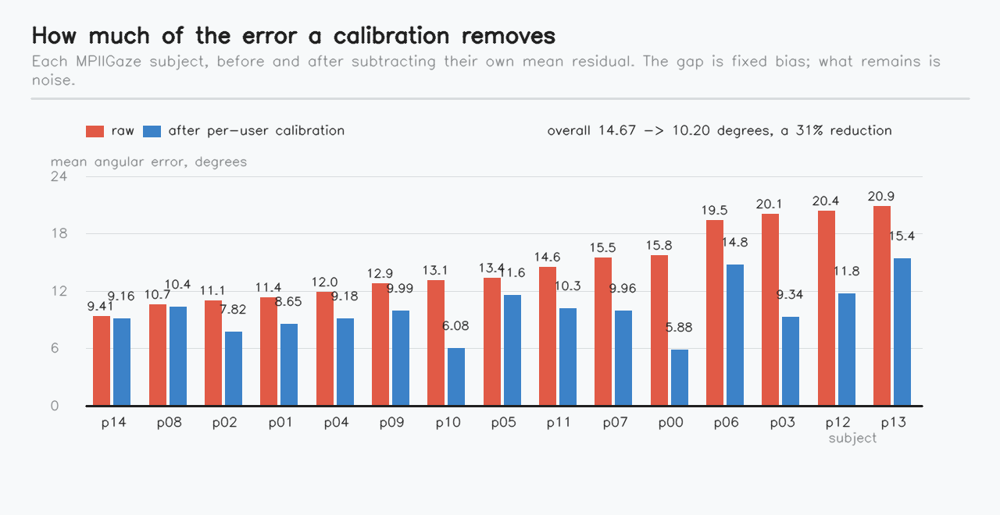

Per-person bias ranged from 3.38 to 18.31 degrees, and the benefit varied a lot: one
subject improved 63%, two others only 3%. Calibration is worth much more to some users than
others, which is an argument for calibrating every user rather than shipping a constant.

**This is why the application classifies into a cone instead of pointing at a target.**
Ten degrees is a usable answer to "are you looking at the screen". It is not a usable
answer to "which icon are you looking at", and no amount of engineering downstream will
change that.

### Every model is faithful on the NPU, but check the behaviour anyway

Feeding each model byte-identical input on CPU and on NPU:

| stage | CPU vs NPU |
|---|---|
| eyegaze gaze output | **0.028 deg** |
| facemap_3dmm head pose | 0.011 deg |
| face_det_lite box, at the detected cell | 0.4 px |

Every model is essentially exact. That is not the whole story, because this pipeline crops
from its own intermediate results: a 0.4 pixel difference in the first stage becomes a
different face crop, which moves the landmarks, which moves the eye patches. Run the whole
chain on one image and the two backends differ by about **5 degrees** of gaze.

Whether that matters depends entirely on what you do with the number. Feed a raw
per-frame direction straight into a threshold and small differences decide which side of
it you land on. Smooth the direction first, as
[Step 7](#step-7-calibrate-then-watch) does, and they stop mattering: on a 1400 frame clip
with a real attention lapse in it, CPU and NPU reported **365 alert frames each**,
identical.

> Per-model delegate faithfulness is necessary and not sufficient. Check your
> application's **behaviour** on the backend you intend to ship on, and smooth any signal
> that feeds a decision boundary.

## Adapting this for in-cabin driver monitoring

The same pipeline is the standard shape of a driver monitoring system, and the model's
own documentation lists that use first. What changes:

- **Camera placement.** A driver-facing camera sits off-axis, below or beside the line of
  sight, so the calibration axis is nowhere near straight ahead. Calibrate in the seat.
- **Lighting.** Cabins run from direct sun to full dark. Production systems use infrared
  illumination and an IR-sensitive sensor for this reason. MPIIGaze is visible-light
  daylight data, so expect the accuracy above to degrade at night.
- **A wider cone, and a shorter dwell.** The road ahead is a large target, and two
  seconds of inattention matters much more at speed than at a desk.
- **Glasses and sunglasses.** Reflections and tint break eye crops well before they break
  face detection.

What this is not: a certified driver monitoring system. Those are validated against
regulatory requirements this guide makes no claim about. Treat this as a way to
understand the pipeline, not as a component to put in a vehicle.

## What this is good for, and what it is not

Three off-the-shelf models, about 400 lines of glue, 25 ms a frame. The interesting part
is not that it runs, it is what the measurements let you claim.

**Works.** Anything that sorts attention into a wide region: is the operator watching the
panel, did the driver check the mirror, how much of a shift was spent facing the work.
These survive 15 degrees because the target is bigger than that, and because a dwell timer
averages many frames instead of trusting one.

**Does not work.** Anything needing to know *where within* a target someone looks. At
60 cm the uncalibrated error covers 31 cm, most of a laptop screen. Gaze-controlled
interfaces and reading analysis need an order of magnitude better, and no downstream
filtering recovers accuracy the model never had.

**That line is a measurement, not an opinion**, which is why
[Step 8](#step-8-how-much-can-you-trust-it) exists. It also moves: per-user calibration
takes 14.67 degrees to 10.20, because a third of the error is fixed bias. Past that, you
need a better model or a closer camera, not more code.

Three things generalise beyond gaze, to any pipeline where one model's output is another
model's input:

- **A stage that crops for the next stage is a coordinate frame, not just a result.** Get
  its geometry subtly wrong, as we did with the head rotation, and every later stage
  inherits the error while still looking plausible.
- **Per-model correctness does not imply pipeline correctness.** Every model here matched
  its CPU reference to a fraction of a degree while the assembled chain differed by five.
- **A conclusion is only as representative as the clip you measured it on.** The
  scheduling advice in this guide reversed completely between a handheld close-up and a
  person sitting at a desk.

## Results

Every number in this guide came from a run on the board. Raw data:

- [`results/bench_log.csv`](results/bench_log.csv): per-model and pipeline timings
- [`results/sched_cost.csv`](results/sched_cost.csv): the detector-scheduling trade, desk footage
- [`results/sched_cost_closeup.csv`](results/sched_cost_closeup.csv): the same, on fast-moving footage
- [`results/mpiigaze_eval.csv`](results/mpiigaze_eval.csv): per-sample angular error
- [`results/mpiigaze_eval_calibration.csv`](results/mpiigaze_eval_calibration.csv): per-person bias
- [`results/sample03-cone30.mp4`](results/sample03-cone30.mp4): the full demo clip through
  the application, at the default 30 degree cone
- [`results/eye-gaze-pipeline.mp4`](results/eye-gaze-pipeline.mp4): the four stages playing
  side by side

## Project structure

```
models/                  the three .tflite files, plus the 3DMM basis arrays
scripts/
  the pipeline and the application
    gaze_common.py       models, decoding, eye patches, fusion
    attention.py         the application
    run_live.sh          launch it on the board's own monitor, for filming
    stop_live.sh         stop it cleanly, so the recording stays playable
    fetch_3dmm_basis.py  download the landmark model's basis arrays
  checks and measurements
    inspect_models.py    input and output tensors of each model
    check_chain.py       run the chain on one image
    check_fusion.py      head-pose composition, scored against ground truth
    verify_backends.py   CPU vs NPU, per model, identical inputs
    bench.py             per-stage and pipeline timings
    spill_probe.py       VTCM spill per model
    export_trimmed.py    re-export EyeGaze without its unused heatmaps output
    bench_trim.py        what dropping that output saves (almost nothing)
    sched_cost.py        what skipping the detector costs
    state_timeline.py    attention state over a clip, as a strip
    eval_mpiigaze.py     accuracy and the calibration test
  figures for this guide
    stage_render.py      shared layout for every figure and stage video
    stage_videos.py      per-stage videos, and the stage stills with --still
    pipeline_strip.py    the four-stage overview
    doc_figures.py       the scheduling and calibration charts
    error_cone.py        render an angular error at a viewing distance
    render_diagrams.py   the mermaid diagrams as PNG, for sites that cannot render them
  development diagnostics
    debug_crops.py       dump the landmarks and eye patches for one image
    compare_landmarks.py eye positions from the detector vs the landmark model
    sweep_crop.py        eye-patch width sweep
results/                 measurements and the annotated demo videos
```

## Troubleshooting

**`Something went wrong (an exception was thrown)` from the export CLI.** See Step 1. Set
`QAIHM_CLI_VERBOSE_EXCEPTIONS=1`, then create the empty `release-assets.yaml`.

**`OSError: [Errno 22]` loading EyeGaze from a script.** It is asking to clone a
repository and nothing answered. Use `always_answer_prompts(True)`.

**The first NPU inference takes seconds.** One-time graph preparation at delegate load,
once per process, with a wall of `Starting stage:` logs. Normal.

**One eye reports the opposite direction from the other.** The mirror convention. Flip
the right eye's patch and negate the right eye's yaw.

**Boxes are offset or faces are missed at the edges.** Letterboxing, or undoing it. See
Step 4.

**Gaze is wildly wrong on stylised photographs.** MPIIGaze is evenly lit, low resolution
webcam imagery. Studio portraits with hard side lighting are a long way outside it. Test
on something resembling your actual deployment.

**The webcam sits at 10 FPS.** Request MJPG before setting the resolution.

## Going further

- Replace the frozen box between detector runs with a tracker, and see whether the
  scheduling trade in Step 7 improves
- Implement MPIIGaze's full normalisation warp, which uses 3D eye position and head pose
  to remove the appearance change caused by head rotation, and measure whether it beats
  the 2D warp used here
- Add a second person. Nothing in the pipeline is single-face except the code that picks
  `faces[0]`
